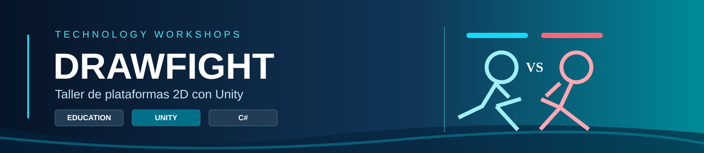

# Taller de Unity 2D — DrawFight

**Formación en videojuegos · Desarrollo de plataformas 2D · Unity y C#**

Utilicé **DrawFight** como proyecto práctico en el taller **«Crea tu primer juego 2D en Unity»** que impartí. A través de un juego de plataformas, trabajamos conceptos de movimiento, física, interacción con objetos y control del estado de partida.

El proyecto conserva **código C#, escenas, recursos y capturas** que permiten seguir el ejercicio y explorar las mecánicas de un juego 2D.


## Qué enseñamos con DrawFight

- Construir un nivel mediante **escenas, GameObjects y componentes**.
- Programar movimiento horizontal y salto con física 2D.
- Cambiar la orientación del personaje según su desplazamiento.
- Implementar una cámara que sigue al jugador con límites.
- Detectar recolección de objetos, obstáculos y llegada a la meta.
- Administrar puntuación, menú, victoria, derrota y reinicio.

## Scripts principales

| Script | Contenido |
| --- | --- |
| [PlayerMovement.cs](Assets/Scripts/PlayerMovement.cs) | Movimiento del personaje, salto, física 2D y orientación |
| [CameraFollow.cs](Assets/Scripts/CameraFollow.cs) | Seguimiento suavizado y límites de cámara |
| [objectCollect.cs](Assets/Scripts/objectCollect.cs) | Triggers, recolección, obstáculos y victoria |
| [GameManager.cs](Assets/Scripts/GameManager.cs) | Puntuación, reinicio y estados de partida |
| [MainMenu.cs](Assets/Scripts/MainMenu.cs) | Menú, pausa y uso de PlayerPrefs |

## Imágenes del proyecto

| Pantalla de inicio | Escenario de juego |
| --- | --- |
|  |  |

*Las imágenes se encuentran alojadas en un servicio externo.*

## Cómo utilizarlo

1. Instala **Unity Hub** y la versión **Unity 2023.2.20f1**, indicada en [ProjectVersion.txt](ProjectSettings/ProjectVersion.txt).
2. Clona el repositorio:

   ```bash
   git clone https://github.com/isaiassolis/unity-2d-platformer-workshop.git
   ```

3. Abre el proyecto desde Unity Hub.
4. Carga `Assets/Scenes/SampleScene.unity` y ejecuta con **Play**.
5. El código utiliza los ejes **Horizontal** y **Jump** del sistema de entrada de Unity.

El repositorio conserva además un ejecutable histórico en la carpeta `Ejecutable/`. Su compatibilidad dependerá del sistema donde se intente abrir.

## Mi participación

Desarrollé y utilicé este proyecto como **material de apoyo para enseñar programación de videojuegos**. Busqué que los participantes pudieran relacionar cada concepto de C# con una respuesta visible en el juego: movimiento, colisiones, puntuación o cambios de escena.

DrawFight es una base para practicar, modificar scripts, experimentar con los niveles e incorporar nuevas mecánicas.

## Sobre el material

El repositorio se presenta como **proyecto didáctico**, no como videojuego comercial terminado. Antes de distribuir una versión modificada, es necesario comprobar las licencias de los recursos de terceros.

**Taller relacionado:** [Chrome Dino — Mecánicas 2D](https://github.com/isaiassolis/unity-2d-chrome-dino-workshop).

---

[Volver a mi portafolio profesional](https://github.com/isaiassolis)
